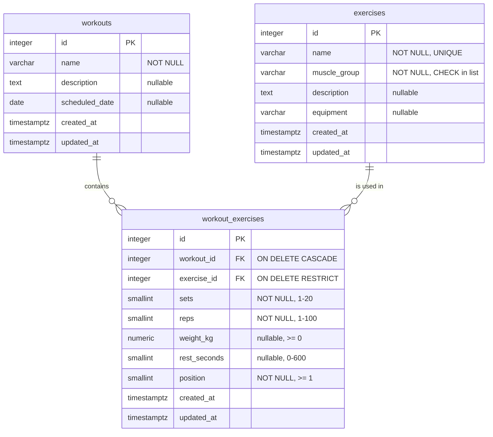

# Syvra Workouts

A small full-stack web app to manage **exercises** and **workouts**. A workout contains many exercises, each with its own sets, reps, weight and rest time.

| | |
|---|---|
| Site | https://syvra-workouts.vercel.app |
| API | https://syvra-workouts.onrender.com (`/health`, `/api/exercises`, `/api/workouts`) |
| Repository | https://github.com/mrjacksonsapien/Syvra-Workouts |

> **Cold start:** the API runs on Render's free tier, which sleeps after 15 minutes without traffic. The first request can take 30–60 seconds; the app shows a "Waking up the server" hint while it waits.

**Stack:** TypeScript · npm workspaces · Express 5 + `pg` (plain SQL) · PostgreSQL 18 · React + Vite + React Router · CSS Modules · zod · Vitest · Docker Compose (local) · Neon / Render / Vercel (production).

## Database (ERD)

`workouts` and `exercises` are many-to-many through the junction table `workout_exercises`, which also holds the data of each pair (sets, reps, weight, rest, order).



Deleting a workout deletes its rows in `workout_exercises`; deleting an exercise that a workout still uses is rejected. The full schema is in [`db/schema.sql`](db/schema.sql).

## Repository pattern

The API is split in layers: **route → controller → service → repository**.

- **Routes** map URLs to controllers.
- **Controllers** handle HTTP only (read the request, choose the status code, send JSON).
- **Services** hold the business rules (for example, "an exercise used in a workout can't be deleted").
- **Repositories** are the only place that runs SQL. Each one is the single gateway to one table (`ExerciseRepository`, `WorkoutRepository`, `WorkoutExerciseRepository`) and exposes methods such as `findById` or `create`. They also map `snake_case` rows to `camelCase` objects.

Why: SQL lives in one place, services read like plain business logic, services and repositories can each be tested with a fake underneath, and replacing `pg` with an ORM would only touch the repositories. All queries are parameterised (`WHERE id = $1`), which prevents SQL injection. More detail in [docs/01-architecture.md](docs/01-architecture.md#repository-pattern).

Validation uses zod schemas from the shared package (`packages/shared`), imported by both the API and the web forms, so the rules are written once.

## Run locally

Requirements: Node 24 (see `.nvmrc`) and Docker.

```bash
npm install
docker compose up
```

This starts PostgreSQL (schema and seed data loaded automatically), the API on http://localhost:3000 and the web app on http://localhost:5173. To wipe the local database (it is re-seeded on the next `up`):

```bash
docker compose down -v
```

Environment variables are documented in `.env.example` and `apps/web/.env.example`; copy them to `.env` / `.env.local` if you run the apps outside Docker.

## Scripts

| Command | What it does |
|---|---|
| `npm test` | Runs all tests (Vitest) |
| `npm run lint` | ESLint |
| `npm run typecheck` | TypeScript checks in every workspace |
| `npm run build:api` / `npm run build:web` | Production builds |
| `npm run format` | Prettier |

## Project layout

```
apps/api         Express API (routes, controllers, services, repositories)
apps/web         React front end
packages/shared  zod schemas and response types used by both apps
db               schema.sql and seed.sql
docs             requirements, architecture, API, deployment, roadmap
```

## Documentation

Start with [docs/00-requirements.md](docs/00-requirements.md). The API endpoints are in [docs/03-api.md](docs/03-api.md) and the hosting setup in [docs/06-deployment.md](docs/06-deployment.md).
