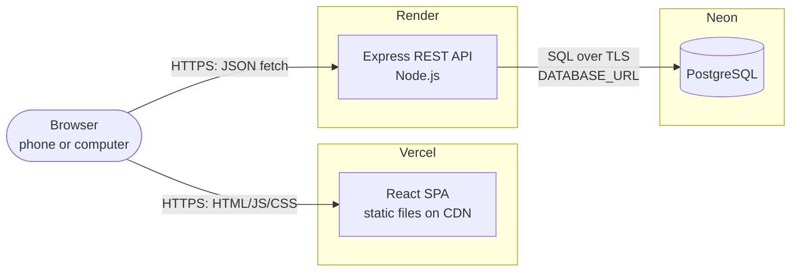
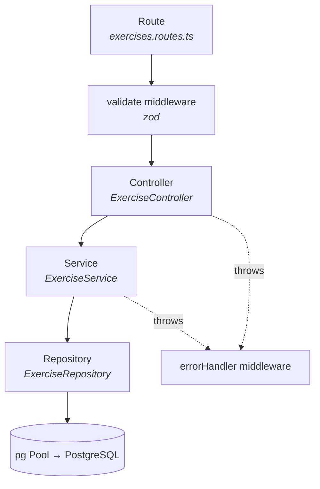

# 01 — Architecture

## Overview



The browser downloads the React app from Vercel, then the app calls the API on Render directly. Only the API knows the database credentials.

## Tech stack

| Concern | Choice | Why |
|---|---|---|
| Language | **TypeScript** (strict) everywhere | Catches errors early |
| Runtime | **Node.js 24 LTS** | Current LTS |
| Repo layout | **One Git repo, npm workspaces** | Small project, one link to review, shared code without copy-paste |
| API | **Express 5** | Standard and minimal; v5 forwards errors thrown in `async` handlers to the error middleware natively |
| DB access | **`pg` (node-postgres) with plain, parameterised SQL** | Shows real SQL (JOINs, constraints); no ORM magic to explain |
| Database | **PostgreSQL 18** (Neon online, Docker locally) | Robust, standard relational database |
| Validation | **zod** in `packages/shared` | One schema, used by the forms *and* the API |
| Front end | **React + Vite + React Router** | Fast dev server and build; standard routing |
| Data fetching | **Own custom hooks** (no TanStack Query) | Shows the hook pattern directly; fewer libraries to explain |
| Styling | **CSS Modules + CSS variables** | Plain CSS, scoped per component, no new framework |
| Tests | **Vitest** (+ React Testing Library, jsdom) | One runner for both apps; Jest-compatible API |
| Local dev | **Docker Compose** (Postgres + API + web) | Disposable local database, one-command startup |
| Hosting | **Neon** (DB), **Render** (API), **Vercel** (web) | Free plans, deploy on `git push` |
| Code quality | ESLint + Prettier | Consistent style |

## Repository layout

```
syvra-workouts/
├── apps/
│   ├── api/                      # Express REST API
│   │   ├── src/
│   │   │   ├── app.ts            # builds the Express app (no listen) → testable
│   │   │   ├── server.ts         # reads env, creates pool, calls app.listen()
│   │   │   ├── config/env.ts     # validates process.env with zod
│   │   │   ├── db/pool.ts        # one shared pg Pool
│   │   │   ├── routes/           # URL → controller method
│   │   │   ├── controllers/      # HTTP in/out
│   │   │   ├── services/         # business rules
│   │   │   ├── repositories/     # SQL only
│   │   │   ├── middleware/       # validate(), errorHandler, notFound
│   │   │   └── errors/           # AppError, NotFoundError, ConflictError
│   │   ├── Dockerfile
│   │   ├── .env.example
│   │   └── package.json
│   └── web/                      # React SPA
│       ├── src/
│       │   ├── api/              # fetch functions (no React)
│       │   ├── hooks/            # custom hooks (React, no HTML)
│       │   ├── components/       # UI building blocks (HTML + CSS Modules)
│       │   ├── pages/            # one component per route
│       │   └── styles/           # tokens.css (brand colours), global.css
│       ├── .env.example
│       └── package.json
├── packages/
│   └── shared/                   # @syvra/shared: zod schemas + TS types + constants
├── db/
│   ├── schema.sql                # tables, constraints, trigger
│   └── seed.sql                  # 15 exercises, 5 workouts
├── docs/                         # this documentation
├── docker-compose.yml
├── vercel.json                   # Vercel build settings + SPA rewrite
├── package.json                  # workspaces + root scripts
├── tsconfig.base.json
├── AGENTS.md / CLAUDE.md         # instructions for AI coding agents
└── README.md                     # links, ERD, Repository pattern, setup
```

### npm workspaces (the *Git* repository's organisation)

The root `package.json` declares `"workspaces": ["apps/*", "packages/*"]`. Each folder with its own `package.json` becomes a workspace package:

- `npm install` at the root installs everything once (one `package-lock.json`).
- `apps/api` and `apps/web` depend on `"@syvra/shared": "*"`; npm links the local folder, so `import { exerciseSchema } from '@syvra/shared'` just works.
- Commands target one package with `-w`: `npm run test -w apps/api`.

`packages/shared` is compiled with `tsc` to `dist/` before the apps build (root scripts handle the order). It must stay **framework-free**: no Express, no React, no DOM.

> Note on vocabulary: the **Git repository** (the project on GitHub) and the **Repository pattern** (a design pattern in the API) share a word but are unrelated. Workspaces organise the Git repo; the pattern organises data access.

## API layers



| Layer | Knows about | Never does |
|---|---|---|
| **Route** | URLs, HTTP verbs, which middleware/controller to call | Logic, SQL |
| **Controller** | `req` / `res`: reads params/body, calls a service, chooses the status code, sends JSON | Business rules, SQL |
| **Service** | Business rules ("an exercise used in workouts can't be deleted", "the workout must exist before adding an exercise") | `req`/`res`, SQL |
| **Repository** | SQL, mapping rows (`snake_case`) to objects (`camelCase`) | Business rules, HTTP |

The rule that routes never query the database is enforced by structure: only `repositories/` imports the pool.

### Example flow: `DELETE /api/exercises/4`

1. Route `router.delete('/:id', validate({ params: idParamSchema }), controller.remove)`.
2. Controller: `await exerciseService.delete(Number(req.params.id)); res.status(204).end();`
3. Service:
   - `exerciseRepository.findById(4)` returns null → `throw new NotFoundError('Exercise 4 not found')`
   - `workoutExerciseRepository.countByExerciseId(4)` returns 3 → `throw new ConflictError('EXERCISE_IN_USE', 'Used in 3 workouts')`
   - otherwise `exerciseRepository.delete(4)`
4. Any thrown `AppError` reaches `errorHandler`, which sends `{ error: { code, message } }` with the right status.

### Dependency injection (composition root)

`app.ts` exports `createApp({ pool })`, which wires the layers by hand:

```ts
const exerciseRepo = new ExerciseRepository(pool);
const workoutExerciseRepo = new WorkoutExerciseRepository(pool);
const exerciseService = new ExerciseService(exerciseRepo, workoutExerciseRepo);
const exerciseController = new ExerciseController(exerciseService);
app.use('/api/exercises', exerciseRoutes(exerciseController));
```

Every class receives its dependencies through its constructor, so tests pass fakes (a fake pool for repositories, fake repositories for services). No DI framework needed.

## Repository pattern

**What:** a repository is an object that is the **only** gateway to the data of one table/entity. It exposes intention-revealing methods (`findAll({ muscleGroup })`, `findById`, `create`, `update`, `delete`) and hides *how* data is stored.

**Why:**
- **Separation of concerns:** SQL is in one place; services read like plain business logic.
- **Testability:** services can be tested with a fake repository; repositories can be tested with a fake pool.
- **Replaceability:** switching from `pg` to an ORM, or Postgres to another store, only changes repositories.

**Here:**

| Repository | Table | Main methods |
|---|---|---|
| `ExerciseRepository` | `exercises` | `findAll(filter)`, `findById`, `findByName`, `create`, `update`, `delete` |
| `WorkoutRepository` | `workouts` | `findAll()` (with exercise count), `findById`, `findByExerciseId` (exercise details page), `create`, `update`, `delete` |
| `WorkoutExerciseRepository` | `workout_exercises` | `findByWorkoutId` (JOIN with exercises), `find(workoutId, exerciseId)`, `add`, `update`, `remove`, `countByExerciseId` |

All SQL uses **parameterised queries** (`WHERE id = $1`, values passed separately), which prevents SQL injection.

**Why no ORM:** an ORM (e.g. Prisma) would also work; repositories would then call `prisma.exercise.findMany()` instead of SQL. We chose plain SQL because relational design (many-to-many, foreign keys, unique pair) is the core of this project, `schema.sql` is the whole schema in one readable file, and every query can be explained line by line.

## Validation and the shared package

`packages/shared` exports, for each entity, a zod schema plus the TypeScript type inferred from it:

```ts
export const MUSCLE_GROUPS = ['chest', 'back', 'legs', 'shoulders', 'arms', 'core', 'full_body'] as const;
export const exerciseInputSchema = z.object({
  name: z.string().trim().min(2).max(80),
  muscleGroup: z.enum(MUSCLE_GROUPS),
  description: z.string().trim().max(500).nullable().optional(),
  equipment: z.string().trim().max(50).nullable().optional(),
});
export type ExerciseInput = z.infer<typeof exerciseInputSchema>;
```

- **Front end:** the form calls `exerciseInputSchema.safeParse(values)` before sending, and shows field errors instantly.
- **API:** the `validate()` middleware parses `req.body` / `req.params` / `req.query` with the same schema and answers `400 VALIDATION_ERROR` if invalid (the client can never be trusted).

zod is a **runtime validation library**, not an API technology like GraphQL. The schemas act as a contract only because both apps import the same package.

## Error model

`errors/AppError.ts` defines `AppError(status, code, message, details?)` and subclasses `ValidationError` (400), `NotFoundError` (404), `ConflictError` (409). The `errorHandler` middleware:
- sends `AppError`s as-is;
- maps PostgreSQL errors as a **safety net**: `23505` unique violation → 409, `23503` foreign-key violation → 409, `23514` check violation → 400;
- logs and hides anything else behind `500 INTERNAL_ERROR`.

Details in [03-api](03-api.md#error-format).

## Local development with Docker

`docker-compose.yml` defines three services:

| Service | Image | Purpose |
|---|---|---|
| `db` | `postgres:18-alpine` | Throwaway local DB. `db/schema.sql` and `db/seed.sql` are mounted into `/docker-entrypoint-initdb.d/` so they run automatically on first start. Health-checked with `pg_isready`. |
| `api` | built from `apps/api/Dockerfile` (dev stage) | Runs `tsx watch src/server.ts` with the source bind-mounted; `DATABASE_URL=postgres://syvra:syvra@db:5432/syvra`. Starts after `db` is healthy. |
| `web` | Node image | Runs `vite --host` with the source bind-mounted; `VITE_API_URL=http://localhost:3000`. |

- `docker compose up`: start everything (web at `http://localhost:5173`, API at `http://localhost:3000`).
- `docker compose up db`: only the database, if you prefer running Node natively.
- `docker compose down -v`: delete the volume → next `up` re-creates and re-seeds a fresh DB.

Docker is **local only**. Production uses Neon/Render/Vercel (see [06-deployment](06-deployment.md)). The same Dockerfile's production stage *can* be used by Render, but that is optional.

## Future: React Native

Not built (YAGNI), but the web app is layered so it would be cheap:

| Folder | Depends on | Reusable in React Native? |
|---|---|---|
| `packages/shared` | zod only | Yes, as-is |
| `apps/web/src/api` | `fetch` + shared types | Yes |
| `apps/web/src/hooks` | React + `api/` | Yes (hooks don't touch the DOM) |
| `apps/web/src/components`, `pages` | HTML, CSS Modules | No (RN uses `<View>`, `<Text>`) |

Migration path: move `api/` and `hooks/` into a new `packages/client` workspace, import it from both `apps/web` and a new `apps/mobile`. **Rule to keep this possible:** files in `api/` and `hooks/` must never import components, CSS or browser-only APIs (`window`, `document`).

## Decision log

| # | Decision | Alternatives considered | Reason |
|---|---|---|---|
| 1 | One Git repo with npm workspaces | One repo per service | Small scope; one link; shared validation |
| 2 | TypeScript everywhere | JavaScript | Safer refactors |
| 3 | Plain SQL with `pg` | Prisma, Drizzle | Shows SQL skills; Repository pattern clearly needed |
| 4 | Routes → controllers → services → repositories | No service layer | Keeps business rules out of HTTP code; testable |
| 5 | zod in a shared package | Separate validation per app | One contract, no drift |
| 6 | Own hooks, one responsive web app | TanStack Query; native app | Fewer dependencies; hooks layer is React-Native-ready |
| 7 | CSS Modules + CSS variables | Tailwind | Plain CSS, nothing new to explain |
| 8 | Vitest | Jest | Shares Vite config; Jest-compatible API |
| 9 | Neon + Render + Vercel | Supabase, Railway, Fly.io | Free, Git-based deploys |
| 10 | Integer identity IDs | UUIDs | Simple; enough for this scale |
| 11 | `updated_at` maintained by a DB trigger | Set in each UPDATE query | Means "row last changed"; can't be forgotten |
| 12 | Block deletion of exercises in use (409) | Cascade | Avoid silently altering workouts |
