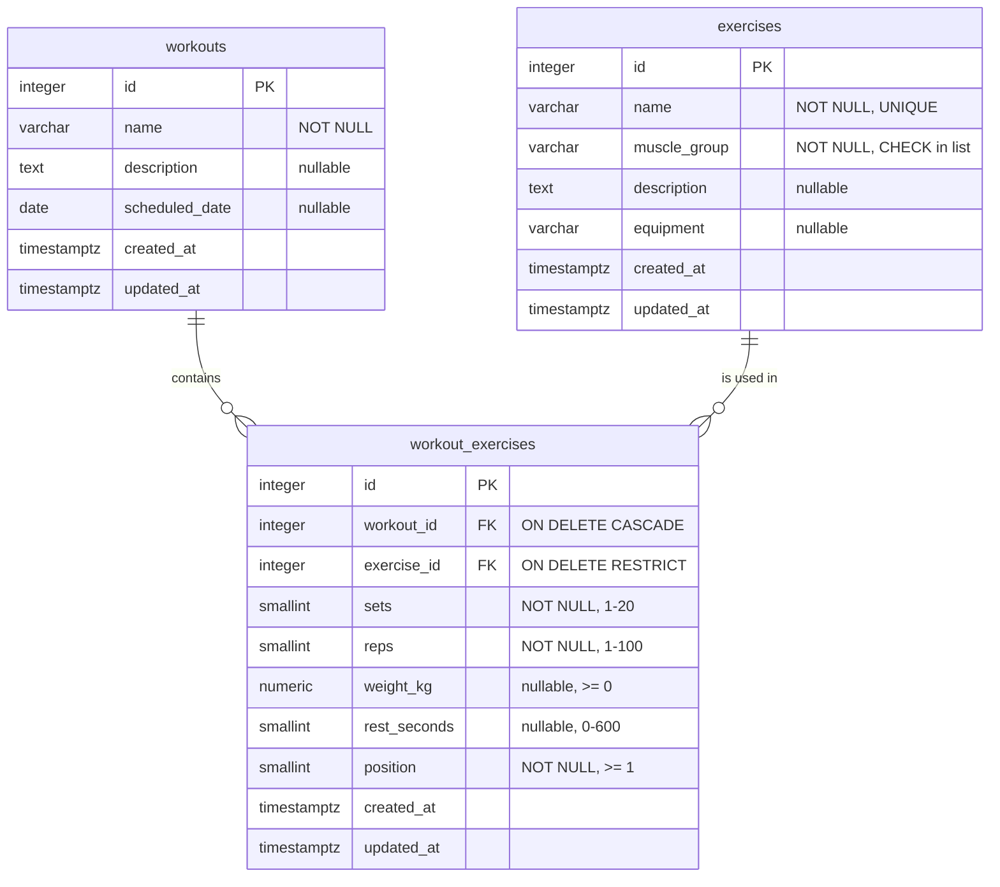

# 02 — Database

PostgreSQL 18. Hosted on **Neon** in production, run in **Docker** locally. The source of truth is `db/schema.sql`, with fictional data in `db/seed.sql`.

## ERD



`workouts` and `exercises` are linked **many-to-many** through the **junction table** `workout_exercises`. It holds the two foreign keys plus the data that belongs to the *pair* (sets, reps, weight, rest, order), not to either side alone.

## Conventions

- Table names: **plural, `snake_case`** (`workouts`, `exercises`). The junction table combines both names, `workout_exercises` ("a workout's exercises"), as listed in the requirements.
- Columns: `snake_case` in SQL; repositories map them to `camelCase` in TypeScript (`muscle_group` → `muscleGroup`).
- Primary keys: `id INTEGER GENERATED ALWAYS AS IDENTITY` (the modern SQL-standard version of `SERIAL`).
- Timestamps: `TIMESTAMPTZ` (stored in UTC), `created_at` / `updated_at` default `now()`.
- Constraints are named explicitly so error messages and mappings are readable.

## Tables

### `exercises`

| Column | Type | Rules | Notes |
|---|---|---|---|
| `id` | integer | PK, identity | |
| `name` | varchar(80) | NOT NULL, UNIQUE | e.g. "Bench Press" |
| `muscle_group` | varchar(20) | NOT NULL, CHECK in list | **One** primary group per exercise (no CSV) |
| `description` | text | nullable | how to perform it |
| `equipment` | varchar(50) | nullable | e.g. "Barbell", "Bodyweight" |
| `created_at`, `updated_at` | timestamptz | NOT NULL, default now() | |

Allowed `muscle_group` values (also exported as `MUSCLE_GROUPS` from `@syvra/shared`):
`chest`, `back`, `legs`, `shoulders`, `arms`, `core`, `full_body`.

*Why a CHECK constraint and not a fourth table:* the design has exactly three tables, and the list is small and stable. Postgres refuses any other value. Supporting several groups per exercise would need another many-to-many table (out of scope).

### `workouts`

| Column | Type | Rules | Notes |
|---|---|---|---|
| `id` | integer | PK, identity | |
| `name` | varchar(80) | NOT NULL | not unique: two "Leg Day"s on different dates are fine |
| `description` | text | nullable | |
| `scheduled_date` | date | nullable | planned day (no time) |
| `created_at`, `updated_at` | timestamptz | NOT NULL, default now() | |

### `workout_exercises` (junction)

| Column | Type | Rules | Notes |
|---|---|---|---|
| `id` | integer | PK, identity | surrogate key |
| `workout_id` | integer | NOT NULL, FK → `workouts.id` **ON DELETE CASCADE** | |
| `exercise_id` | integer | NOT NULL, FK → `exercises.id` **ON DELETE RESTRICT** | |
| `sets` | smallint | NOT NULL, CHECK 1–20 | |
| `reps` | smallint | NOT NULL, CHECK 1–100 | |
| `weight_kg` | numeric(6,2) | nullable, CHECK ≥ 0 | null = bodyweight / not set |
| `rest_seconds` | smallint | nullable, CHECK 0–600 | rest between sets |
| `position` | smallint | NOT NULL, CHECK ≥ 1 | display order in the workout |
| `created_at`, `updated_at` | timestamptz | NOT NULL, default now() | |
| — | — | **UNIQUE (`workout_id`, `exercise_id`)** | the "unique pair" |

## Key rules explained

### The unique pair
`UNIQUE (workout_id, exercise_id)` means an exercise can appear **at most once** per workout. It is a rule of the data model. It also makes `(workoutId, exerciseId)` a natural identifier, so the API addresses a link as `/api/workouts/:workoutId/exercises/:exerciseId`. Its index also speeds up "all exercises of workout X" queries.

### Delete behaviour
| Action | Effect | Mechanism |
|---|---|---|
| Delete a **workout** | Its rows in `workout_exercises` are deleted; the exercises themselves stay | `ON DELETE CASCADE` on `workout_id` |
| Delete an **exercise** used in ≥ 1 workout | **Refused** with `409 EXERCISE_IN_USE` ("Used in N workouts") | Service checks first (friendly message); `ON DELETE RESTRICT` makes the DB refuse too (safety net) |
| Delete an unused exercise | Deleted | |

### `updated_at`
Meaning: **when the row last changed**, whatever caused it. That is a data fact, not a business decision, so the database maintains it with one trigger function shared by all three tables. Repositories never set it. Editing a link (`workout_exercises`) updates that link's `updated_at`, not the parent workout's. If a business-level "last modified by the user" concept were ever needed, it would be a separate column set by a service.

### `position`
When an exercise is added, it goes last: `position = COALESCE(MAX(position), 0) + 1` for that workout, computed **inside the INSERT statement** (no separate read, so no race). It is not unique, so removing an exercise doesn't require renumbering; lists are ordered by `position, id`.

## `db/schema.sql` (planned content)

```sql
-- Idempotent for local resets
DROP TABLE IF EXISTS workout_exercises, workouts, exercises CASCADE;

CREATE OR REPLACE FUNCTION set_updated_at() RETURNS trigger AS $$
BEGIN
  NEW.updated_at := now();
  RETURN NEW;
END;
$$ LANGUAGE plpgsql;

CREATE TABLE exercises (
  id            INTEGER GENERATED ALWAYS AS IDENTITY PRIMARY KEY,
  name          VARCHAR(80)  NOT NULL,
  muscle_group  VARCHAR(20)  NOT NULL,
  description   TEXT,
  equipment     VARCHAR(50),
  created_at    TIMESTAMPTZ  NOT NULL DEFAULT now(),
  updated_at    TIMESTAMPTZ  NOT NULL DEFAULT now(),
  CONSTRAINT exercises_name_unique UNIQUE (name),
  CONSTRAINT exercises_muscle_group_check CHECK (muscle_group IN
    ('chest','back','legs','shoulders','arms','core','full_body'))
);

CREATE TABLE workouts (
  id              INTEGER GENERATED ALWAYS AS IDENTITY PRIMARY KEY,
  name            VARCHAR(80) NOT NULL,
  description     TEXT,
  scheduled_date  DATE,
  created_at      TIMESTAMPTZ NOT NULL DEFAULT now(),
  updated_at      TIMESTAMPTZ NOT NULL DEFAULT now()
);

CREATE TABLE workout_exercises (
  id            INTEGER GENERATED ALWAYS AS IDENTITY PRIMARY KEY,
  workout_id    INTEGER  NOT NULL REFERENCES workouts(id)  ON DELETE CASCADE,
  exercise_id   INTEGER  NOT NULL REFERENCES exercises(id) ON DELETE RESTRICT,
  sets          SMALLINT NOT NULL CHECK (sets BETWEEN 1 AND 20),
  reps          SMALLINT NOT NULL CHECK (reps BETWEEN 1 AND 100),
  weight_kg     NUMERIC(6,2)      CHECK (weight_kg >= 0),
  rest_seconds  SMALLINT          CHECK (rest_seconds BETWEEN 0 AND 600),
  position      SMALLINT NOT NULL CHECK (position >= 1),
  created_at    TIMESTAMPTZ NOT NULL DEFAULT now(),
  updated_at    TIMESTAMPTZ NOT NULL DEFAULT now(),
  CONSTRAINT workout_exercises_pair_unique UNIQUE (workout_id, exercise_id)
);

-- The unique pair index already covers lookups by workout_id; add one for exercise_id
CREATE INDEX workout_exercises_exercise_id_idx ON workout_exercises (exercise_id);
CREATE INDEX exercises_muscle_group_idx ON exercises (muscle_group);

CREATE TRIGGER exercises_set_updated_at BEFORE UPDATE ON exercises
  FOR EACH ROW EXECUTE FUNCTION set_updated_at();
CREATE TRIGGER workouts_set_updated_at BEFORE UPDATE ON workouts
  FOR EACH ROW EXECUTE FUNCTION set_updated_at();
CREATE TRIGGER workout_exercises_set_updated_at BEFORE UPDATE ON workout_exercises
  FOR EACH ROW EXECUTE FUNCTION set_updated_at();
```

> `numeric` values come back from `pg` as **strings** (to avoid float precision loss). `WorkoutExerciseRepository` converts `weight_kg` with `Number()`; a common pitfall.

## Seed data

`db/seed.sql` inserts exercises first, then workouts, then links. Links look up ids **by name** (`(SELECT id FROM exercises WHERE name = 'Bench Press')`) so the seed doesn't depend on generated id values.

### 15 exercises

| # | Name | Muscle group | Equipment |
|---|---|---|---|
| 1 | Bench Press | chest | Barbell |
| 2 | Push-Up | chest | Bodyweight |
| 3 | Pull-Up | back | Pull-up bar |
| 4 | Barbell Row | back | Barbell |
| 5 | Lat Pulldown | back | Cable machine |
| 6 | Back Squat | legs | Barbell |
| 7 | Romanian Deadlift | legs | Barbell |
| 8 | Walking Lunge | legs | Dumbbells |
| 9 | Overhead Press | shoulders | Barbell |
| 10 | Lateral Raise | shoulders | Dumbbells |
| 11 | Biceps Curl | arms | Dumbbells |
| 12 | Triceps Dip | arms | Parallel bars |
| 13 | Hanging Leg Raise | core | Pull-up bar |
| 14 | Cable Crunch | core | Cable machine |
| 15 | Kettlebell Swing | full_body | Kettlebell |

### 5 workouts (sets × reps @ weight, rest)

| Workout | Scheduled | Exercises (in order) |
|---|---|---|
| **Push Day** | next Monday | Bench Press 4×8 @ 60 kg, 120 s · Overhead Press 3×10 @ 35 kg, 90 s · Push-Up 3×15, 60 s · Triceps Dip 3×10, 60 s |
| **Pull Day** | next Tuesday | Pull-Up 4×6, 120 s · Barbell Row 4×8 @ 50 kg, 90 s · Lat Pulldown 3×12 @ 45 kg, 60 s · Biceps Curl 3×12 @ 12 kg, 60 s |
| **Leg Day** | next Thursday | Back Squat 5×5 @ 80 kg, 180 s · Romanian Deadlift 3×10 @ 60 kg, 120 s · Walking Lunge 3×12 @ 14 kg, 90 s |
| **Full Body Express** | none | Kettlebell Swing 4×15 @ 16 kg, 60 s · Back Squat 3×8 @ 60 kg, 90 s · Push-Up 3×12, 45 s · Pull-Up 3×5, 90 s |
| **Core & Shoulders** | none | Hanging Leg Raise 3×12, 60 s · Cable Crunch 3×15 @ 30 kg, 45 s · Lateral Raise 3×15 @ 8 kg, 45 s · Overhead Press 3×8 @ 30 kg, 90 s |

This gives exercises used in several workouts (Push-Up, Pull-Up, Back Squat, Overhead Press) for the exercise details page and the 409 demo. "Next Monday"-style dates are computed in SQL (`CURRENT_DATE + ...`) so the data never looks stale.

## Running the SQL

- **Locally (Docker):** automatic on the first `docker compose up`; reset with `docker compose down -v`.
- **Neon:** `psql "$DATABASE_URL" -f db/schema.sql && psql "$DATABASE_URL" -f db/seed.sql`, or paste the files into Neon's SQL Editor.

## Decision: full reset instead of migrations

The project has no migration tool. Changes to tables or data are made by editing `db/schema.sql` or `db/seed.sql` and re-running them. There is no CI job that changes the database.

- **Why:** this is a small project with fictional data. A reset is simple, always gives the same result, and avoids a migration runner, a `schema_migrations` table and a CI job, which would add more to build and explain than the project needs.
- **Cost:** `schema.sql` drops and recreates the tables, so every run deletes all data, including anything written in production. Changing the structure or the seed always means a reset.
- **When this would change:** once there are real users whose data must survive a change, the schema would move to numbered migrations (`db/migrations/001_…sql`) applied by CI on `main`. The seed would stay dev-only.

To change the schema or seed on Neon: edit the file, then run the two `psql` commands above against `DATABASE_URL_UNPOOLED`. Tell users the data resets when this happens.
